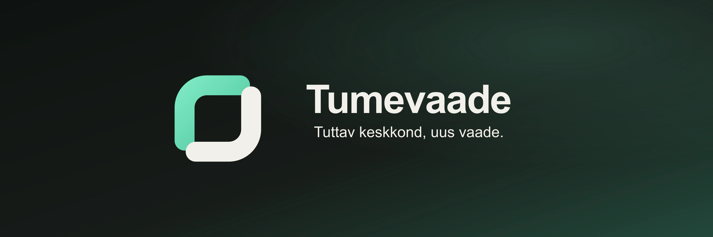
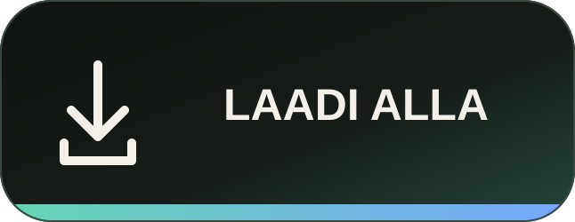
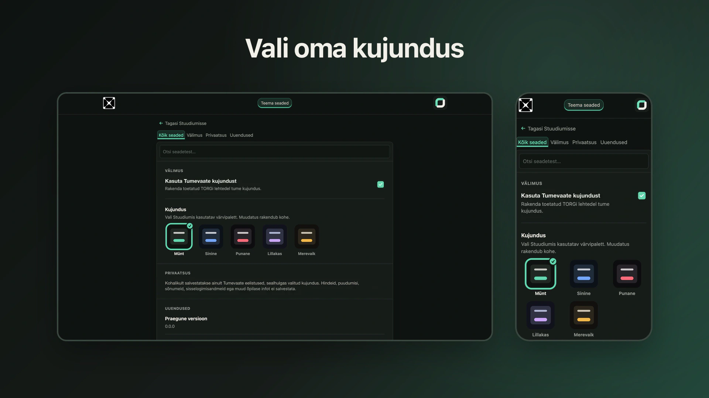

# Tumevaade

  
  
<strong>TORGi õpilaselt TORGi õpilastele.</strong>

## Installimine

  
    

## Mis on Tumevaade?

Tumevaade täiendab päris TORG Stuudiumit, säilitades selle tuttava ülesehituse ja tööviisi. See lisab tumeda kujunduse, võimaluse välimust enda järgi kohandada ning praktilisi täiustusi nii arvutis kui ka Androidis.

Projekt sündis minu igapäevasest kogemusest TORGi õpilasena. Tahtsin, et tuttav Stuudium oleks isikupärasem, pimedas silmadele rahulikum ja mugavam kasutada. Projekt areneb päris kasutuses märgatud valukohtade ja vajaduste põhjal. Praegu keskendub Tumevaade TORGi õpilastele ja Stuudiumi õpilasevaatele.

## Ekraanipildid

  <picture>
    <source media="(max-width: 600px)" srcset="assets/readme/screenshots/cross-device-home-narrow.webp">
    
  </picture>

  <picture>
    <source media="(max-width: 600px)" srcset="assets/readme/screenshots/cross-device-settings-narrow.webp">
    
  </picture>

- [Vaata rohkem ekraanipilte →](SCREEN_SHOT.md)

## Omadused

- Läbimõeldud tume kujundus
- Erinevad kujundused
- Seaded Stuudiumis
- Eraldiseisev Androidi rakendus

## Saadavus

| Platvorm             | Saadavus      | Kontrollitud keskkond |
| -------------------- | ------------- | --------------------- |
| Android              | Saadaval      | Android 16            |
| Chrome ja Brave      | Saadaval      | Chrome ja Brave       |
| Firefox, Safari, iOS | Pole toetatud | —                     |

## Privaatsus ja sõltumatus

Sinu kooliandmeid ei koguta ega saadeta arendajale. Tumevaade salvestab ainult toimimiseks vajalikud seaded sinu seadmesse. Sisselogimist ja kooliandmeid töötleb päris Stuudium.

Tumevaade on sõltumatu ja mitteametlik projekt TORG Stuudiumile. See ei ole Stuudiumi ega TORGi ametlik toode.

Täpsem selgitus on [privaatsuspoliitikas](docs/PRIVACY.md).

## Tagasiside ja panustamine

Probleemidest ja ettepanekutest saab teada anda [GitHubi probleemide lehe kaudu](https://github.com/rixerpixer007/Tumevaade/issues).

  
Arendajale

- [Brauserilaienduse arendamine](docs/EXTENSION_DEVELOPMENT.md)
- [Agentide taustal töötav testbrauser](docs/BACKGROUND_BROWSER_TESTING.md)
- [Androidi rakenduse ehitamine ja testimine](docs/MOBILE_DEVELOPMENT.md)
- [Projekti npm-käsud](docs/NPM_COMMANDS.md)

## Litsents

Tumevaade on avaldatud [MIT-litsentsi](LICENSE) alusel.
